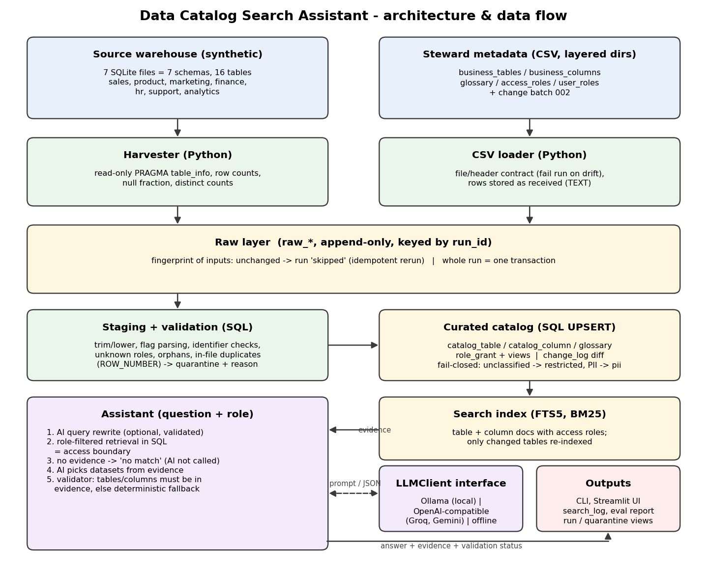

# Data Catalog Search Assistant: submission summary

**Assignment:** DAI-041 (AI + Data) · **Candidate:** Nikhil Dubey · **Stack:** Python 3.10+, SQLite (SQL, FTS5), optional Ollama / OpenAI-compatible LLM, Streamlit, pytest

**Links:** GitHub repository: https://github.com/Nikhil-Dubey-0/data-catalog-search-assistant · Demo video: *to be added*

## Problem

Users need to find the right dataset by describing it in plain language. Answers must show **table and column evidence** and respect a simple **access-role** field: nobody should see, or be told about, metadata their role isn't granted.

## Solution in one paragraph

A metadata pipeline **harvests** technical metadata (tables, columns, types, null %, distinct counts) from a synthetic 7-schema warehouse and merges it with **steward CSVs** (descriptions, owners, tags, PII flags, access roles, glossary). Rows land in a raw layer unchanged. SQL staging standardises, validates and de-duplicates them, and bad rows go to a **quarantine** table with a reason. Curated tables are maintained with **UPSERT, change log and soft delete**, and only changed tables are re-indexed in an **FTS5** search index. Runs are fingerprinted (identical inputs are skipped) and atomic (one transaction). The assistant retrieves candidates with **BM25 + glossary synonyms**, with the **role filter inside the retrieval SQL**. An optional LLM rewrites the question and explains the best datasets from that evidence, and a **validator rejects any answer citing tables outside the evidence**, falling back to a deterministic answer.



## Key decisions

- **Fail closed:** an unclassified table becomes `restricted`, and an unclassified PII-named column becomes `pii`.
- **Access enforced at retrieval, not in the prompt:** restricted metadata never reaches the model (tested on the actual prompt).
- **Quarantine, don't drop:** each bad steward row is kept with its reason. A broken file *header* fails the run instead.
- **Glossary instead of embeddings (for now):** transparent and dependency-free, and measured to help (hit@1 0.909 → 0.955, MRR 0.909 → 0.977).
- **AI as an untrusted component:** it adds keywords and explanations only. Its output is validated, and the system works fully offline.

## Results

| Check | Result |
|---|---|
| Automated tests | **49 passed** (pipeline, access, search, AI failure modes, HTTP retries, eval gate) |
| Evaluation (29 labelled questions, offline) | **28/29 pass, 0 policy leaks, 0 label violations** |
| Retrieval with glossary | hit@1 **0.955**, hit@3 **1.0**, MRR **0.977** |
| Mutation check | disabling the table filter → 4 tests fail; the column filter → 1; the validator leak check → 1 |
| Clean clone + new venv | setup and full test suite pass |
| Demonstrated edge cases | idempotent rerun, header drift, mid-run rollback, unknown role, hallucinated/leaky/malformed AI output, model outage, schema change |

## Limitations and next steps

Keyword retrieval misses some paraphrases (eval q24, "bought"), so I would add hybrid BM25 + embeddings. The access model is single-role and the role isn't authenticated, so I would map SSO groups to roles and share policies with the warehouse. SQLite would become Postgres/dbt with a scheduler. The eval set is small and author-labelled; I would grow it and run it in CI per model version. The live LLM path is covered by contract and fake-model tests but wasn't run against a real model in the build environment.

## How to run

```
pip install -r requirements.txt
python -m catalog_assistant setup
python -m catalog_assistant ask "employee salaries by department" --role hr_partner
pytest
streamlit run app/streamlit_app.py
```
