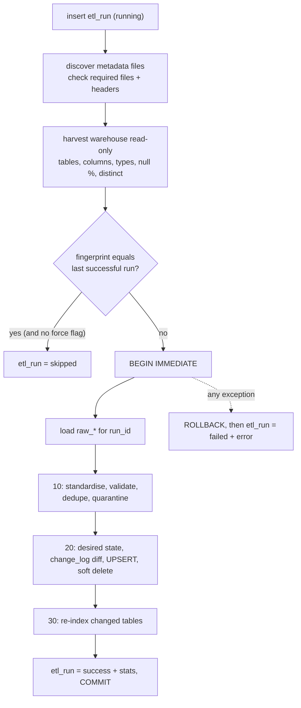
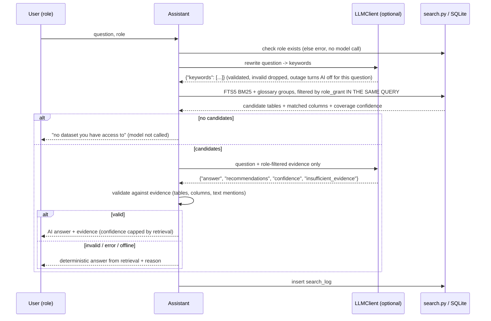
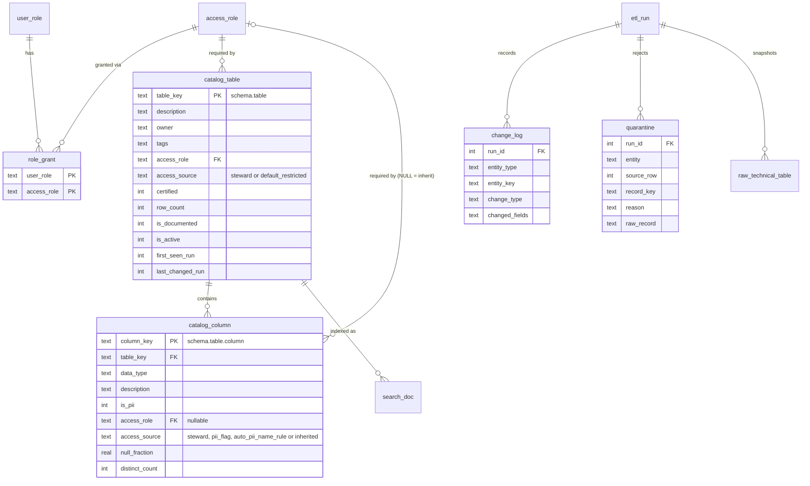

# Architecture and data model

## Layers

| Layer | Objects | Written by | Behaviour on rerun |
|---|---|---|---|
| Source | `var/warehouse/<schema>.db` (7 files, 16 tables) | `warehouse.py` (seeded) | regenerated only with `--force` |
| Source | `data/metadata/*.csv`, `data/changes/batch_002/*.csv` | data stewards | layered: later directories override earlier ones |
| Control | `etl_run` | `pipeline.py` | one row per run: running → success / skipped / failed |
| Raw | `raw_technical_table/column`, `raw_business_table/column`, `raw_glossary`, `raw_access_role`, `raw_user_role` | Python | append-only, keyed by `run_id`; values kept as received (TEXT) |
| Staging | `stg_business_table/column`, `stg_glossary` | SQL (`10_…`) | rebuilt every run; standardised; `reject_reason` set by validation rules |
| Quarantine | `quarantine` | SQL (`10_…`) | rejected rows + reason + raw record (JSON) per run |
| Curated | `catalog_table`, `catalog_column`, `glossary_term`, `access_role`, `user_role`, `role_grant` | SQL (`20_…`) | UPSERT; soft delete (`is_active = 0`); `first_seen/last_changed/last_seen_run` |
| Change history | `change_log` | SQL (`20_…`) | added / modified (with field list) / removed / reactivated per run |
| Search | `search_doc` (FTS5) | SQL (`30_…`) | only tables in this run's `change_log` re-indexed; full build on cold start |
| Consumption | `v_role_visible_table`, `v_role_visible_column`, `v_metadata_quality`, `v_run_summary`, `search_log` | views / assistant | |

## Pipeline run (python -m catalog_assistant build)

## Ask flow (python -m catalog_assistant ask)

## Entity-relationship (curated + control)

## Roles and grants (data/metadata)

| user_role | granted access levels |
|---|---|
| viewer | public (the unknown grant `marketing_ro` is quarantined, not applied) |
| analyst | public, internal |
| finance_analyst | public, internal, finance |
| hr_partner | public, internal, hr |
| admin | public, internal, finance, hr, pii, restricted |

## Validation rules (staging, first failing rule wins)

| Entity | Rule | Example in the sample data |
|---|---|---|
| table/column | key present | glossary row with empty term |
| table/column | identifiers match `[a-z0-9_]` after trim/lower | `  SALES ,  Orders ` is *standardised*, not rejected |
| table | `access_role` present and known | `superuser` → rejected → table fails closed to `restricted` |
| column | `access_role` known if given | `secret` |
| table | `certified` ∈ Y/N/yes/no/true/false/1/0/blank | `maybe` |
| column | `is_pii` same | `maybe` |
| table/column | object exists in this run's harvest | `sales.legacy_orders_2019`, `customers.loyalty_points` |
| all | no in-file duplicate key (last valid row wins) | `support.tickets`, `sales.orders.total_amount`, glossary `revenue` |
| grants | granted access level exists | `viewer -> marketing_ro` |
